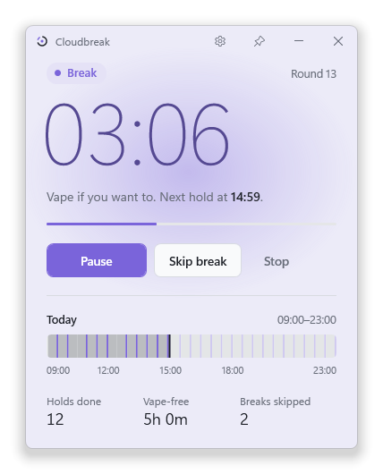
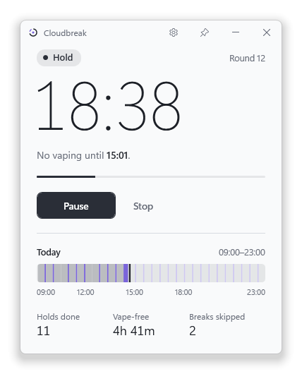
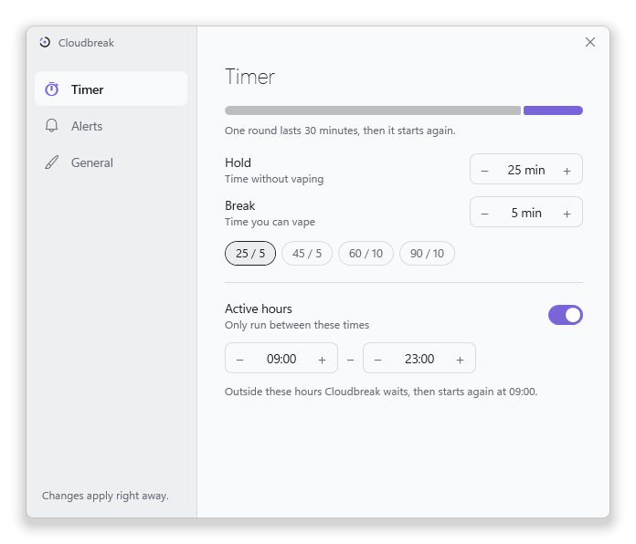
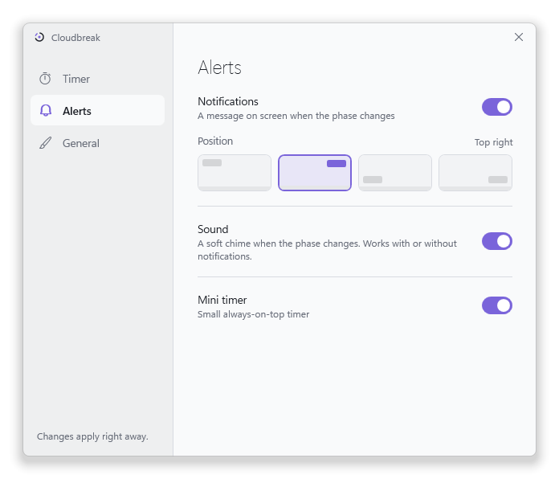

<div align="center">


# Cloudbreak

**Twenty-five minutes without. Five minutes with.**

A pomodoro timer for vaping less, for Windows.<br>
Start it once and it loops on its own: hold, break, hold again, until you stop it.

<a href="../../releases/latest"></a>


<a href="LICENSE"></a>

<br><br>

<picture>
  <source media="(prefers-color-scheme: dark)" srcset="docs/screens/main-break-dark.png">
  
</picture>

</div>

## How it works

The day is a row of rounds. Each round is a **hold**, time without vaping, followed by a **break**, time you can vape. When one ends, the next one starts and you get a quiet notification.

<table>
  <tr>
    <td align="center" width="50%">
      <picture>
        <source media="(prefers-color-scheme: dark)" srcset="docs/screens/main-hold-dark.png">
        
      </picture>
      <br><b>Hold</b><br>Black and white. It tells you when you can vape next.
    </td>
    <td align="center" width="50%">
      <picture>
        <source media="(prefers-color-scheme: dark)" srcset="docs/screens/main-break-dark.png">
        
      </picture>
      <br><b>Break</b><br>The only color in the app. Skip it if you don't need it.
    </td>
  </tr>
</table>

The bar under **Today** shows every hold and break of the day, so you can see how it is going at a glance.

## Features

- **Your rhythm.** Pick the hold and break lengths, or use a preset: 25/5, 45/5, 60/10, 90/10.
- **Active hours.** Outside them Cloudbreak waits, then starts again on its own.
- **Starts with Windows** and lives next to the clock. The tray ring fills as the round goes by.
- **Notifications** in the screen corner you choose. Sound on or off, separately.
- **Mini timer.** A small always-on-top chip with the time left. Drag it anywhere.
- **Today's numbers.** Rounds completed, vape-free time, breaks skipped. Paused time never counts.
- **Fits your Windows.** Light or dark theme, violet or your Windows accent color, English or Italian.

## Settings

<table>
  <tr>
    <td width="50%">
      <picture>
        <source media="(prefers-color-scheme: dark)" srcset="docs/screens/settings-timer-dark.png">
        
      </picture>
    </td>
    <td width="50%">
      <picture>
        <source media="(prefers-color-scheme: dark)" srcset="docs/screens/settings-alerts-dark.png">
        
      </picture>
    </td>
  </tr>
</table>

## Install

1. Download the **Cloudbreak-Setup** installer from the [latest release](../../releases/latest).
2. Run it. Windows may show *"Windows protected your PC"* because the installer isn't signed: click **More info**, then **Run anyway**.
3. Choose **Just for me** (no admin password needed), pick a folder, and finish.

Needs Windows 10 or 11 (64-bit) and the free [.NET 10 Desktop Runtime](https://dotnet.microsoft.com/download/dotnet/10.0). If it's missing, the installer tells you and opens the download page.

**Uninstall** from *Settings → Apps → Installed apps → Cloudbreak*. It removes everything it added: the app, its settings and stats, the start-with-Windows entry, the shortcuts and the tray icon record.

## Light on your PC

- Ticks once a second only while something is on screen. Otherwise it sleeps until the next phase or the next minute.
- No redraws while the screen is off or the PC is locked.
- Runs in Windows efficiency mode when no window is open.
- About 20 MB of memory and a fraction of a percent of one CPU core.

## Privacy

Cloudbreak never connects to the internet. No accounts, no telemetry, no updates in the background. Settings and today's numbers stay on your PC, in `%APPDATA%\Cloudbreak`.

## Build from source

You need the [.NET 10 SDK](https://dotnet.microsoft.com/download/dotnet/10.0) and [Inno Setup 6](https://jrsoftware.org/isinfo.php).

```powershell
powershell -ExecutionPolicy Bypass -File build\build.ps1
```

The installer is written to `Setup\`.

| Folder | What's inside |
|---|---|
| `src/Cloudbreak/` | The app: C#, WPF, .NET 10 |
| `build/` | Build script, installer script (Inno Setup), icon generator |
| `assets/` | App icon |
| `docs/` | Images for this page |
| `design/` | Interactive design mockup (HTML) |

## License

[MIT](LICENSE) © 2026 [Lorenzo-Boffredo](https://github.com/Lorenzo-Boffredo). Free to use, change and share; keep the copyright notice.

<br>

<details>
<summary><b>Italiano</b></summary>

<br>

**Venticinque minuti senza. Cinque minuti con.**

Cloudbreak è un timer pomodoro per svapare meno, per Windows. Lo avvii una volta e va avanti da solo: **resisti** (niente svapo, 25 minuti di base), poi **pausa** (puoi svapare, 5 minuti), e si ripete finché non lo fermi.

**Installazione**

1. Scarica il setup **Cloudbreak-Setup** dall'[ultima release](../../releases/latest).
2. Aprilo. Se Windows mostra *"Windows ha protetto il PC"*, clicca **Ulteriori informazioni** e poi **Esegui comunque**: il setup non è firmato.
3. Scegli **Solo per me** (non serve la password di amministratore), la cartella, e finisci.

Serve Windows 10 o 11 a 64 bit e il [.NET 10 Desktop Runtime](https://dotnet.microsoft.com/download/dotnet/10.0), gratuito. Se manca, il setup te lo dice.

**Disinstallazione** da *Impostazioni → App → App installate → Cloudbreak*. Toglie tutto quello che ha aggiunto, senza lasciare file.

L'app è in italiano e in inglese e segue la lingua di Windows. Non si collega mai a internet: impostazioni e statistiche restano sul tuo PC.

</details>
